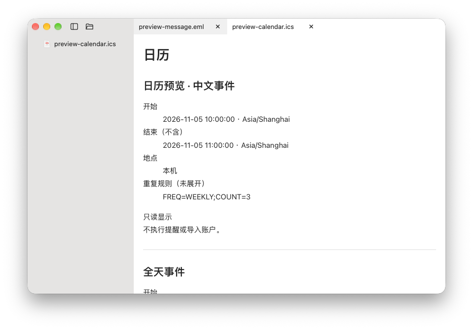

# CatView

[](https://awesomemygo.dev/apps/catview)

English · [简体中文](README.zh-CN.md)

**Open a folder. Read your files.**

A lightweight macOS file reader with a native file tree and tabs. Browse documents, code, images and media in one window, without importing them into a library. Built with [MyGo](https://github.com/egoist/mygo), using macOS viewers where they fit.

[Download v0.1.7](https://github.com/sogud/catview/releases/tag/v0.1.7) · [Release notes](CHANGELOG.md) · [Report an issue](https://github.com/sogud/catview/issues) · [MIT license](LICENSE)



## Install

**macOS 12 or later · Apple Silicon (arm64).** No Intel build is currently provided. Some decoders require newer macOS versions.

1. Download `CatView-0.1.7-macos-arm64.zip` from [Releases](https://github.com/sogud/catview/releases/tag/v0.1.7).
2. Unzip it and move `CatView.app` to Applications.
3. If macOS blocks the app, verify its source, then use **System Settings → Privacy & Security → Open Anyway**.

The app is ad-hoc signed, **not Developer ID signed or Apple notarized**. The updater's Ed25519 signature verifies update authenticity; it does not replace Apple notarization. Choose the ZIP for manual installation; the TAR.GZ and JSON assets are for the updater.

<details>
<summary>Terminal installation and removal</summary>

Read [install.sh](install.sh) before running it:

```sh
curl -fsSL https://raw.githubusercontent.com/sogud/catview/main/install.sh | VERSION=v0.1.7 sh
```

The script checks the published SHA-256, installs to `/Applications` (or `~/Applications` when needed), and removes the quarantine attribute. Only run it if you trust the source. Omit `VERSION` to select the newest release, including prereleases.

To remove the app while keeping settings:

```sh
curl -fsSL https://raw.githubusercontent.com/sogud/catview/main/install.sh | sh -s -- --uninstall
```

</details>

## Use

Text and source-code files are editable immediately and remain editable after saving. Markdown and HTML keep their preview: use the **pencil icon** at the top of the reader or **⌘E** to enter or finish editing. The editor receives focus immediately; use **⌘S** to save. Unsaved changes still require confirmation before leaving editing mode.

Reading mode checks the current file for external changes about once per second and reloads it; other tabs are checked after switching. Automatic reload pauses for unsaved changes and while explicitly editing Markdown or HTML; saving still checks for external conflicts. Reloading HTML, PDF and similar previews may reset the reading position.

Normal quit saves open folders and tabs for the next launch without an explicit file argument. Unsaved edits still use save/discard prompts. The Dock menu includes recent items. Window positions and crash recovery are not restored.

Choose separate reading and code fonts in **Settings → Reading**. Fonts come from your Mac; the code picker lists monospaced families. Changes apply to Markdown, code, HTML and EPUB, without changing fixed-layout PDF or Quick Look documents.

Markdown code blocks have a separate **Code block theme** setting: follow the reading theme, light, or dark. Use dark code blocks on a white reading surface; inline code keeps the reading theme.

Drop folders onto the CatView Dock icon to open each folder in a new window, keeping existing windows and tabs.

To open files from Finder, choose **Open With → CatView**. To make it the default for a file type, use **Get Info → Open with → Change All**. CatView does not change your defaults automatically.

**File → New window** (⌘N) or **Open folder in new window** keeps folders and tabs independent. **Recent items** lists ten entries; **Open history** stores up to 100 distinct files/folders locally, with timestamps, opening in another window and clearing history. Tab context menus close other/left/right/all tabs, copy paths or reveal files; batch closing stops when an unsaved-change prompt is cancelled.

Open a file or folder from the welcome screen. Click a folder to expand it and a file to open a tab; opening the same file again reuses its tab. Recent folders are available from the File menu.

Right-click the tree to create a file or folder, rename an item, reveal it in Finder, or move it to Trash after confirmation. Existing files are never overwritten by these operations.

Text opens read-only. Choose **File → Edit file** to edit explicitly. Saving checks for external changes; closing prompts about unsaved edits.

| Action | Shortcut |
| --- | --- |
| Open file / folder | ⌘O / ⇧⌘O |
| Toggle sidebar | ⌘B |
| Settings | ⌘, |
| Close tab / window | ⌘W / ⇧⌘W |
| Find in source / save edits | ⌘F / ⌘S |
| Increase / decrease text size (12–48) or image zoom | ⌘+ / ⌘− |
| Reset text size (15) / fit image | ⌘0 |
| Preview bitmap at 100% | ⌘1 |
| Previous / next TIFF or CBZ page | ⌥← / ⌥→ |

The View menu contains source, zoom and system-preview options. Preview failures provide a reason, retry, Open in Default App and Show in Finder.

## Read and preview

| Content | What you can do |
| --- | --- |
| Markdown / HTML | Read tables, local images and highlighted code. Markdown supports anchors, local file links in tabs, and offline Mermaid diagrams with light/dark colors. Document scripts are blocked. |
| Code / text | Highlight common languages; edit explicitly. Small JSON, XML and XML plist files have a formatted reading view that preserves the original source. |
| CSV / TSV | Browse a native table, resize columns and copy cells. Values remain strings, preserving leading zeros and large integers. |
| Images | Fit or zoom PNG, JPEG, WebP, BMP, HEIC/HEIF and AVIF; play GIFs, browse TIFF pages and display ICO/ICNS. Static SVGs reject scripts, animation and embedded resources. |
| PDF / EPUB | Read PDFs using WebKit. Reflowable EPUBs have chapter navigation, text sizing and saved progress. |
| Office | Basic DOCX/PPTX content; DOC uses system conversion and legacy PPT shows a first-page preview. XLSX, XLS, RTF, ODT and iWork files use Quick Look. |
| Audio / video | Native AVKit controls for supported MP4/M4V/MOV, M4A/MP3/WAV/AIFF and other system codecs. Playback starts only when requested and stops when leaving the tab. |
| EML / ICS | Read email headers, body and attachment names, or calendar events and time zones. No account access, attachment opening, event import or reminders. |
| Archives / comics | List ZIP, TAR, TAR.GZ/TGZ, TAR.BZ2/TBZ2 and system-supported 7z/RAR contents without extraction. CBZ images use natural filename order and page navigation. CBR lists contents only. |

### Compatibility boundaries

System viewers depend on macOS, installed extensions and file encoding. A container extension does not guarantee that its codec can play. Quick Look can return only a file icon; use the basic preview or an external application in that case. Directory-based iWork packages are not accepted. Office layout, fonts, slide masters and animations may differ from their authoring apps; XLSX is read-only and does not calculate formulas.

**Experimental system formats:** PSD, TGA, EXR, JPEG 2000, JPEG XL, DDS and camera RAW (DNG, CR2/CR3, NEF/NRW, ARW/SR2, RAF, ORF, RW2, PEF, SRW) use ImageIO's composite or preview image. AAC, CAF, FLAC and AC3/EAC3 use AVKit. These formats, individual camera models, RAR variants, ICO and TAR.BZ2 have not all been tested interactively. There is no layer editor, RAW development or HDR/color-fidelity guarantee. The System Preview menu can also try DOCM, PPTM, XLSM, XLSB, ODP and ODS, without promising an available renderer.

**Not supported:** DRM, fixed-layout EPUB, MOBI/AZW/KFX, MKV/AVI/WebM, OGG/Opus and TAR.XZ. EPUB publisher styling is only partially supported. HTML/PDF/Office scroll positions are not preserved across tabs. Some small HTML-containing Markdown files may open blank when launched directly from the command line. Rename or remove the opened root folder in Finder.

<details>
<summary>Preview size and resource limits</summary>

- Text/Markdown/HTML/CSV: 12 MiB. Tables: 20,000 rows, 128 columns or 200,000 cells. JSON/XML formatting: 2 MiB; larger text remains available as source.
- Images: 36 MiB, 100 million source pixels; preview longest edge up to 4096 pixels. GIF: 300 frames, 4096 pixels per edge, canvas pixels × frames up to 64 Mi. TIFF: 512 pages. SVG: 4 MiB.
- Quick Look documents and ZIP: 50 MiB. Archives: 20,000 entries. TAR/7z/RAR: 100 MiB, up to eight seconds; TAR scans up to 256 MiB decompressed data and system archive listings up to 2 MiB output. Encrypted directories and some compression methods are unsupported.
- CBZ: 100 MiB, 2,000 images, 36 MiB per image; encrypted entries and unsafe paths are rejected. Images are read in memory, not extracted to disk.
- EML: 12 MiB, 200 MIME parts, 16 levels; body sections up to 2 MiB, 4 MiB combined. Images are disabled. ICS: 1 MiB, 512 components and 32 levels; only VEVENT is displayed, recurrence rules are not expanded, and unsupported custom time zones retain their original values.

</details>

## Appearance and updates

The default macOS theme uses a white/dark-gray reading area and system sidebar material. Choose from seven light/dark palettes, adjust the accent color, font size, line spacing and text width. The interface can follow the system language or select one of 18 languages; translations and RTL layout are incomplete.

Automatic update checks run about every six hours. Downloads are verified before offering **Install and Restart**; installation requires that click and is blocked by unsaved edits. Settings has separate automatic-check and automatic-download switches. Manual checking remains in the app menu. Installation requires a writable app folder.

Alpha 5 users can upgrade through the updater. Alpha 4 and earlier should install the current ZIP manually once.

## Privacy and security

Files are read locally, with no default document upload or telemetry. Update checks contact public GitHub release endpoints. Clicking an external link opens its destination through the system.

Optional translation supports Markdown/TXT below 1 MiB. It sends the current document only after you choose translation and confirm a provider. Results do not overwrite the file. Provider settings and keys are stored locally as plaintext with user-only permissions, **not in Keychain**. Google/Youdao web interfaces are unofficial; translation-provider integration remains experimental.

Report reproducible bugs through [Issues](https://github.com/sogud/catview/issues), using synthetic files when possible. Do not post credentials or private documents. For security-sensitive reports, use GitHub's private vulnerability reporting if available; otherwise ask for a private contact without disclosing exploit details publicly.

## Build and contribute

On macOS, install the Go version required by [go.mod](go.mod), clone this repository and run:

```sh
go mod download
go run github.com/egoist/mygo/cmd/mygo build -skip-dmg
```

The Apple Silicon app is written to `build/darwin-arm64/CatView.app`. Dependencies use published modules, without sibling checkouts. Other platforms are not validated. Normal builds need no release key; signed update packages require the maintainer's existing `MYGO_UPDATER_PRIVATE_KEY`. Never commit or distribute a private key.

Focused issues and pull requests are welcome. Describe the user-visible change, include relevant verification and keep the single-tree, single-reader layout. Run `go vet .` and the build for code changes. AI-assisted contributions are welcome when reviewed by the contributor; do not submit private prompts, session logs or generated claims that were not checked. There is currently no CI workflow or separate code of conduct; keep discussions respectful.

## License and credits

[MIT](LICENSE). CatView uses [MyGo](https://github.com/egoist/mygo), Mermaid, Goldmark, go-message, go-ical and macOS frameworks. File icons come from [Material Icon Theme](https://github.com/material-extensions/vscode-material-icon-theme). See [third-party notices](THIRD_PARTY_LICENSES.txt) and the [icon license](assets/filetype-material-icon-theme-LICENSE.txt).

The CatView name and cat artwork have not undergone trademark clearance; no exclusive trademark claim is made.
