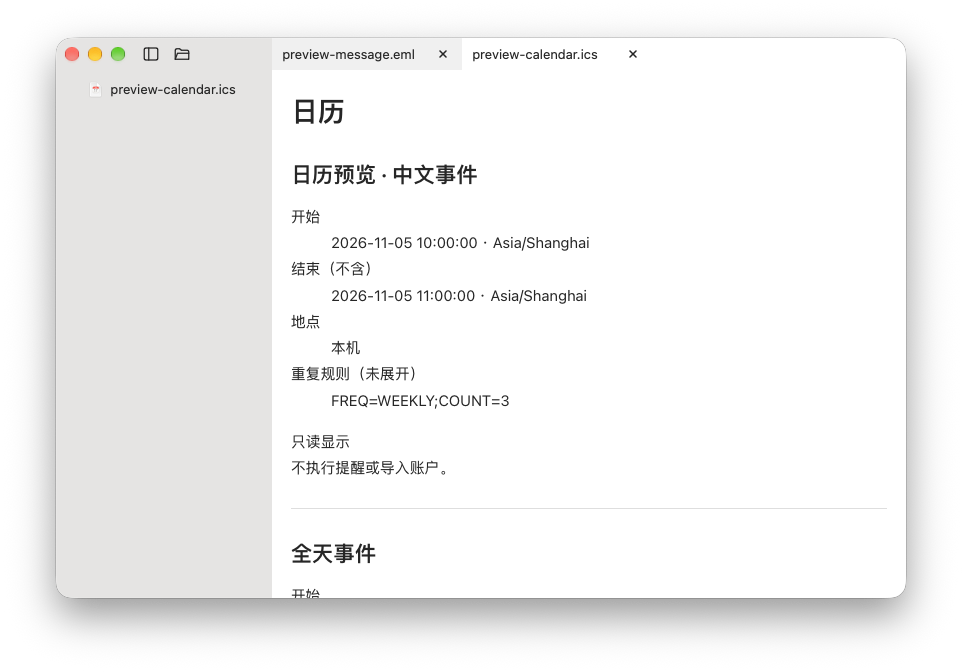

# CatView

[English](README.md) · 简体中文

**打开文件夹，即刻阅读。**

一个轻量的 macOS 本地文件阅读器，提供原生文件树和多标签页。在同一窗口浏览文档、代码、图片与媒体，无需导入资料库。基于 [MyGo](https://github.com/egoist/mygo) 构建，按需复用 macOS 系统预览能力。

[下载 v0.1.6](https://github.com/sogud/catview/releases/tag/v0.1.6) · [更新记录](CHANGELOG.md) · [反馈问题](https://github.com/sogud/catview/issues) · [MIT 协议](LICENSE)



## 安装

**macOS 12 或更新版本 · Apple Silicon（arm64）。** 暂无 Intel 安装包。部分解码能力需要较新的 macOS。

1. 从 [Releases](https://github.com/sogud/catview/releases/tag/v0.1.6) 下载 `CatView-0.1.6-macos-arm64.zip`。
2. 解压，将 `CatView.app` 拖入「应用程序」。
3. 若 macOS 阻止打开，请先确认来源，再到「系统设置 → 隐私与安全性」选择「仍要打开」。

应用仅做临时签名，**尚无 Developer ID 签名或 Apple 公证**。更新包的 Ed25519 签名用于验证更新来源，不替代 Apple 公证。手动安装请选择 ZIP；TAR.GZ 和 JSON 文件供自动更新使用。

<details>
<summary>终端安装与卸载</summary>

执行前请先阅读 [install.sh](install.sh)：

```sh
curl -fsSL https://raw.githubusercontent.com/sogud/catview/main/install.sh | VERSION=v0.1.6 sh
```

脚本核对发布的 SHA-256，安装到 `/Applications`，必要时使用 `~/Applications`，并移除 quarantine 标记。请仅在信任来源时运行。不指定 `VERSION` 时选择最新版本，可能包含预发布版。

卸载应用并保留设置：

```sh
curl -fsSL https://raw.githubusercontent.com/sogud/catview/main/install.sh | sh -s -- --uninstall
```

</details>

## 使用

在「设置 → 阅读」中分别选择阅读字体和代码字体。使用本机字体，代码字体只列等宽字体；应用于 Markdown、代码、HTML 和 EPUB，不修改 PDF 或 Quick Look 固定版式文档。

将文件夹拖到 Dock 中的 CatView 图标，每个文件夹会在新窗口打开，保留已有窗口和标签。

在 Finder 中通过「打开方式 → CatView」打开文件。若要设为某类文件的默认应用，选择「显示简介 → 打开方式 → 全部更改」。CatView 不会自动修改默认应用。

通过「文件 → 新建窗口」（⌘N）或「在新窗口打开文件夹」独立管理各窗口的文件夹和标签。「最近打开」显示 10 项；「打开历史」在本机保存最多 100 项不同文件/文件夹及时间，可在新窗口打开或清空。标签右键可关闭其他/左侧/右侧/全部标签、复制路径或在 Finder 显示；批量关闭遇到未保存提示时，取消会停止后续关闭。

从欢迎页打开文件或文件夹。单击文件夹展开，单击文件打开标签；再次打开同一文件会复用已有标签。「文件」菜单可返回最近打开的目录。

右键文件树可新建文件或文件夹、重命名、在 Finder 中显示，或确认后移到废纸篓。这些操作不会覆盖已有文件。

文本默认只读。通过「文件 → 编辑文件」显式开启编辑；保存时检测外部改动，关闭时提示未保存内容。

| 操作 | 快捷键 |
| --- | --- |
| 打开文件 / 文件夹 | ⌘O / ⇧⌘O |
| 显示或隐藏侧栏 | ⌘B |
| 设置 | ⌘, |
| 关闭标签 / 窗口 | ⌘W / ⇧⌘W |
| 源码查找 / 保存编辑 | ⌘F / ⌘S |
| 放大／缩小文字（12–48）或图片 | ⌘+ / ⌘− |
| 恢复默认字号（15）／图片适应窗口 | ⌘0 |
| 预览位图 100% | ⌘1 |
| TIFF 或 CBZ 上一页 / 下一页 | ⌥← / ⌥→ |

「显示」菜单提供源码、缩放和系统预览选项。预览失败会说明原因，并提供重试、用默认应用打开和在 Finder 中显示的入口。

## 阅读与预览

| 内容 | 功能 |
| --- | --- |
| Markdown / HTML | 表格、本地图片和代码高亮；Markdown 支持锚点、本地文件链接在标签页打开，以及明暗配色的离线 Mermaid 图表。文档脚本被禁用。 |
| 代码 / 文本 | 常见语言高亮与显式编辑。小型 JSON、XML、XML plist 提供格式化阅读，同时保留原始源码。 |
| CSV / TSV | 原生表格、可调列宽和单元格复制。数值按字符串保留，不丢失前导零和长整数。 |
| 图片 | PNG、JPEG、WebP、BMP、HEIC/HEIF、AVIF 适应窗口和缩放；GIF 动画、TIFF 翻页、ICO/ICNS 显示。静态 SVG 拒绝脚本、动画和嵌入资源。 |
| PDF / EPUB | PDF 使用 WebKit 阅读；可重排 EPUB 支持章节导航、字号调整与进度保存。 |
| Office | DOCX/PPTX 基础内容；DOC 使用系统转换，旧 PPT 预览首页。XLSX、XLS、RTF、ODT 和 iWork 文件使用 Quick Look。 |
| 音视频 | AVKit 原生控件播放系统支持的 MP4/M4V/MOV、M4A/MP3/WAV/AIFF 等编码。主动点击才播放，离开标签后停止。 |
| EML / ICS | 邮件头、正文和附件名称，或日历事件与时区。不访问账户、不打开附件、不导入事件或执行提醒。 |
| 压缩包 / 漫画 | 列出 ZIP、TAR、TAR.GZ/TGZ、TAR.BZ2/TBZ2 以及系统支持的 7z/RAR 目录，不解压。CBZ 按文件名自然排序翻页；CBR 只列目录。 |

### 兼容范围

系统预览依赖 macOS、已安装的扩展和文件编码。容器扩展名不代表其中的编码一定可播放。Quick Look 可能只返回文件图标，此时请用基础预览或外部应用。暂不接受目录式 iWork 文档包。Office 的排版、字体、幻灯片母版和动画可能与原软件不同；XLSX 仅供阅读，不计算公式。

**实验性系统格式：** PSD、TGA、EXR、JPEG 2000、JPEG XL、DDS 和相机 RAW（DNG、CR2/CR3、NEF/NRW、ARW/SR2、RAF、ORF、RW2、PEF、SRW）使用 ImageIO 合成图或预览图。AAC、CAF、FLAC、AC3/EAC3 使用 AVKit。这些格式、各相机型号、RAR 变体、ICO 和 TAR.BZ2 尚未全部交互实测。不提供图层编辑、RAW 冲洗或 HDR/色彩保真保证。「系统预览」也可尝试 DOCM、PPTM、XLSM、XLSB、ODP 和 ODS，但不保证系统有对应渲染器。

**尚不支持：** DRM、固定版式 EPUB、MOBI/AZW/KFX、MKV/AVI/WebM、OGG/Opus、TAR.XZ。EPUB 出版社样式仅部分支持。HTML/PDF/Office 切换标签后不保留滚动位置。部分带 HTML 的小型 Markdown 经命令行直接启动时可能出现空白。重命名或删除当前根文件夹请使用 Finder。

<details>
<summary>文件大小与资源限制</summary>

- 文本/Markdown/HTML/CSV：12 MiB。表格：20,000 行、128 列或 200,000 单元格。JSON/XML 格式化：2 MiB；更大的文本仍可看源码。
- 图片：36 MiB、源图 1 亿像素，预览长边最多 4096 像素。GIF：300 帧、每边 4096 像素，画布像素乘帧数最多 64 Mi。TIFF：512 页。SVG：4 MiB。
- Quick Look 文档和 ZIP：50 MiB。压缩包：20,000 条目。TAR/7z/RAR：100 MiB、最多八秒；TAR 扫描解压数据最多 256 MiB，系统压缩包目录输出最多 2 MiB。不支持加密目录及部分压缩方法。
- CBZ：100 MiB、2,000 张图片、单张 36 MiB；拒绝加密条目和不安全路径。图片只读入内存，不解压到磁盘。
- EML：12 MiB、200 个 MIME 部件、16 层；正文单段最多 2 MiB、合计 4 MiB，禁用图片。ICS：1 MiB、512 个组件、32 层；仅显示 VEVENT，不展开重复规则，无法支持的自定义时区保留原值。

</details>

## 外观与更新

默认 macOS 主题采用白色/深灰阅读区和系统侧栏材质。可选七套明暗配色，调整强调色、字号、行距和正文宽度。界面可跟随系统或从 18 种语言中选择；翻译和 RTL 布局尚不完整。

约每六小时自动检查更新。下载并验证后显示「安装并重启」，点击才安装；未保存的编辑会阻止安装。设置中可分别关闭自动检查和自动下载，应用菜单保留手动检查入口。安装需要应用所在文件夹可写。

Alpha 5 用户可通过更新器升级；Alpha 4 及更早版本请先手动安装一次当前 ZIP。

## 隐私与安全

文件在本机阅读，不默认上传文档或收集遥测。更新检查访问公开的 GitHub 发布接口，点击外部链接会通过系统打开目标地址。

可选翻译支持小于 1 MiB 的 Markdown/TXT。只有主动选择翻译并确认服务后才发送当前文档，结果不会覆盖原文件。服务配置和密钥以仅当前用户可读写的本地明文保存，**未使用 Keychain**。Google/有道网页接口非官方；翻译服务整合仍属实验功能。

通过 [Issues](https://github.com/sogud/catview/issues) 反馈可复现问题，尽量使用合成示例文件，不要上传凭据或私密文档。安全敏感问题请优先使用 GitHub 私密漏洞报告（如已启用）；否则先询问私密联系方式，不在公开讨论中披露利用细节。

## 构建与贡献

在 macOS 安装符合 [go.mod](go.mod) 要求的 Go，克隆仓库后运行：

```sh
go mod download
go run github.com/egoist/mygo/cmd/mygo build -skip-dmg
```

Apple Silicon 产物位于 `build/darwin-arm64/CatView.app`。使用公开模块依赖，无需同级源码仓库；其他平台未验证。普通构建不需要发布密钥；签名更新包需要维护者原有的 `MYGO_UPDATER_PRIVATE_KEY`。不要提交或分发私钥。

欢迎范围明确的 Issue 和 Pull Request。说明用户能看到的变化与相关验证，保持单文件树、单阅读区布局。代码变更请运行 `go vet .` 和构建。欢迎经贡献者审阅的 AI 辅助贡献，但不要提交私密提示词、会话日志或未经检查的生成结论。目前没有 CI 工作流或独立行为准则文件，请保持尊重的交流方式。

## 协议与致谢

[MIT](LICENSE)。CatView 使用 [MyGo](https://github.com/egoist/mygo)、Mermaid、Goldmark、go-message、go-ical 和 macOS 框架。文件图标来自 [Material Icon Theme](https://github.com/material-extensions/vscode-material-icon-theme)。详见[第三方声明](THIRD_PARTY_LICENSES.txt)和[图标许可](assets/filetype-material-icon-theme-LICENSE.txt)。

CatView 名称和猫图形尚未完成商标可用性核查，不主张独占商标权。
